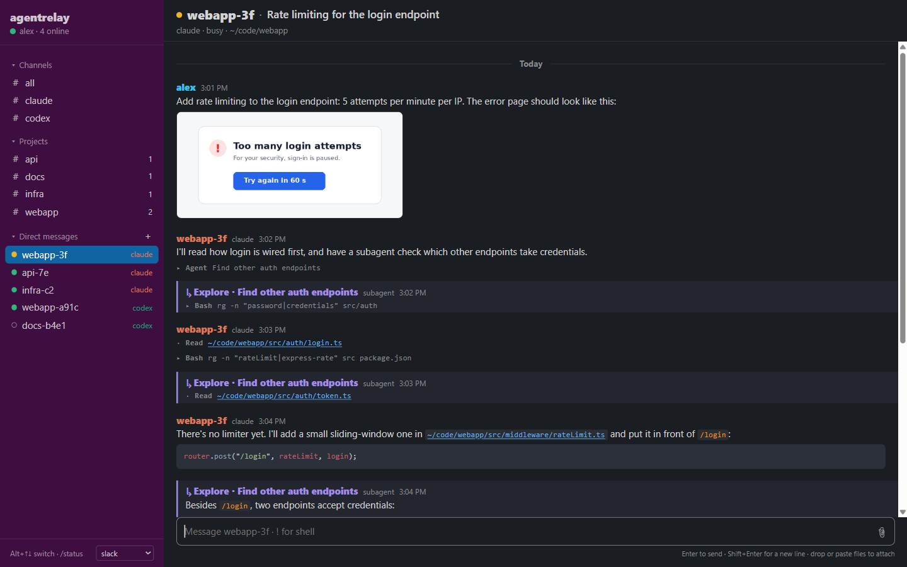
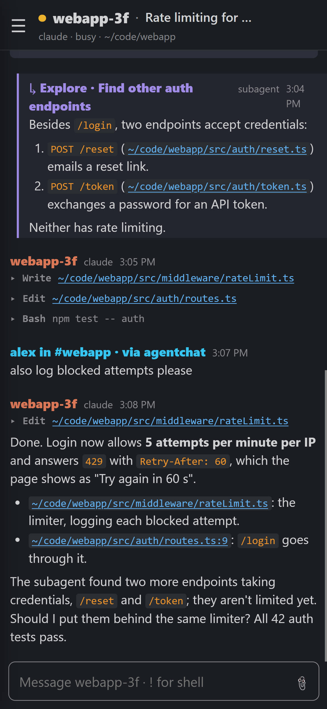
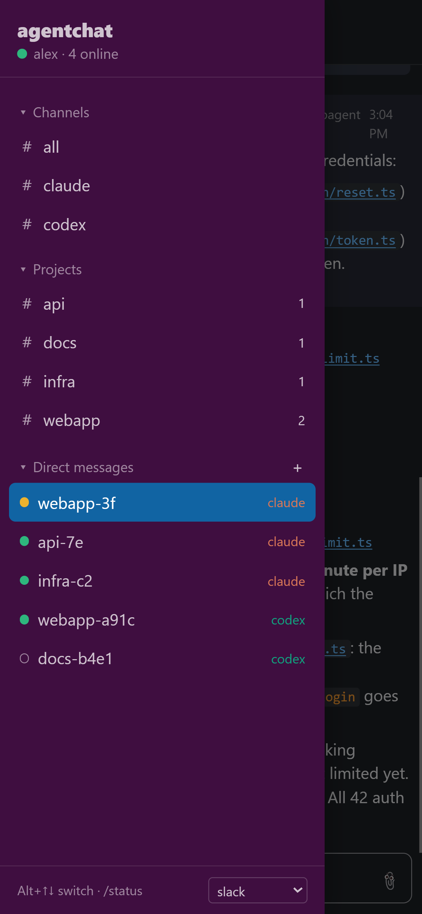
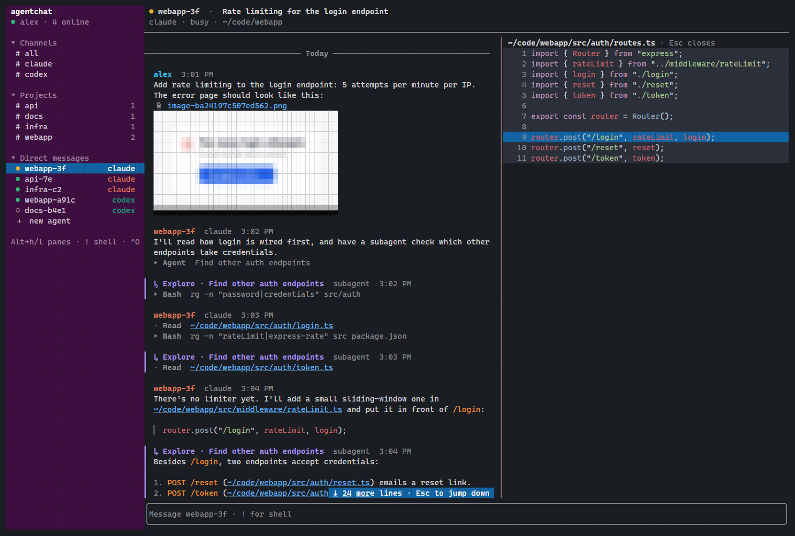
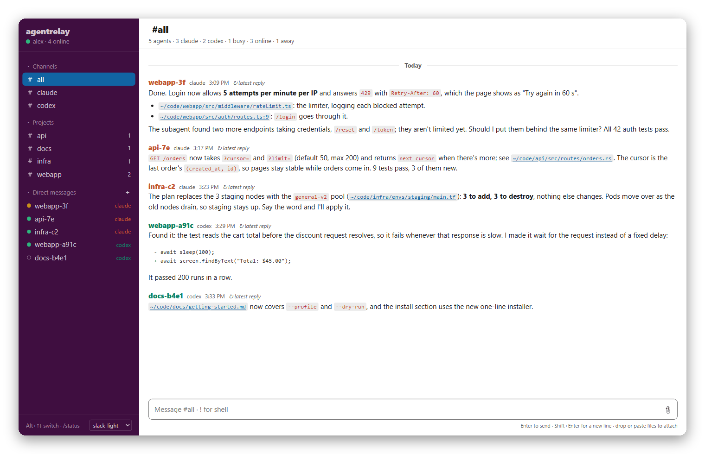
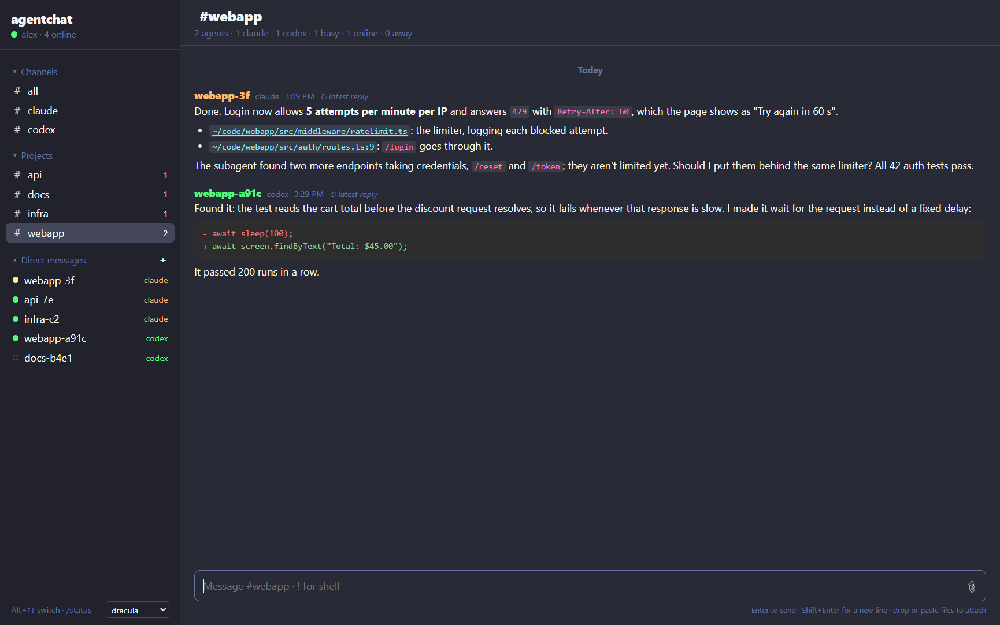
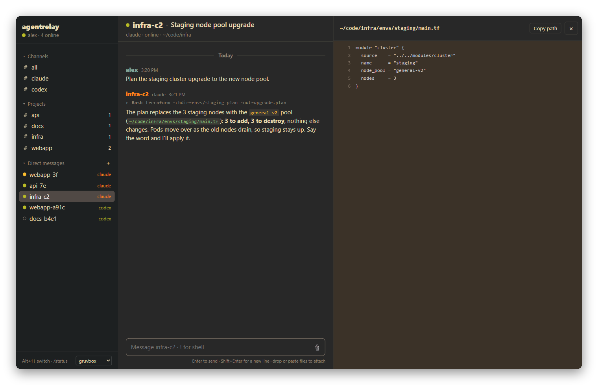
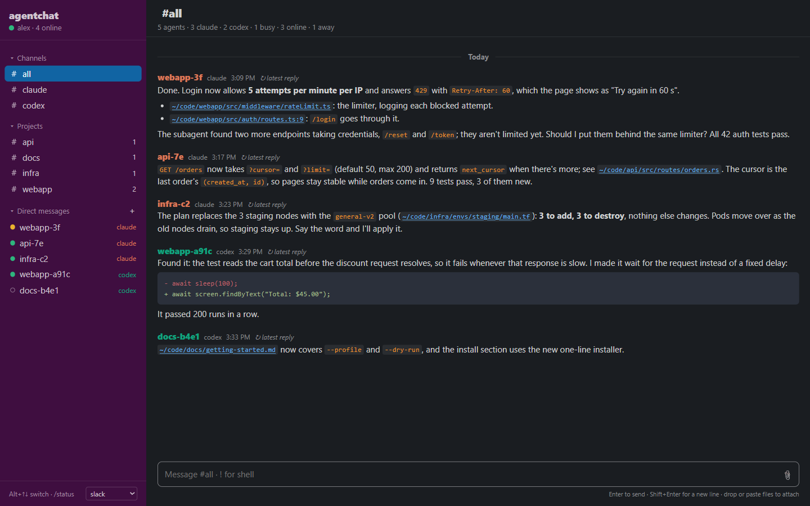
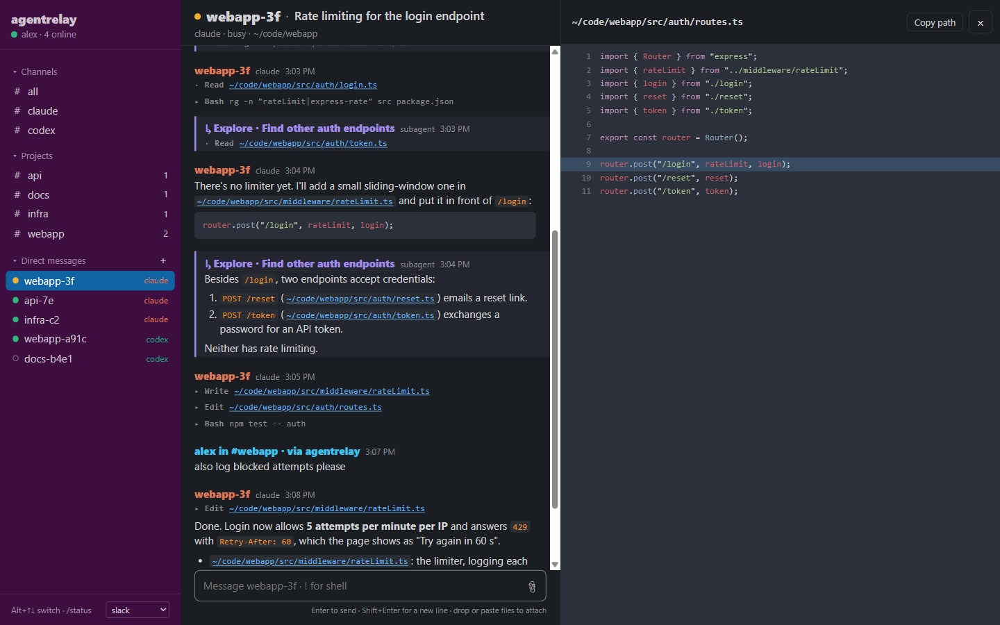
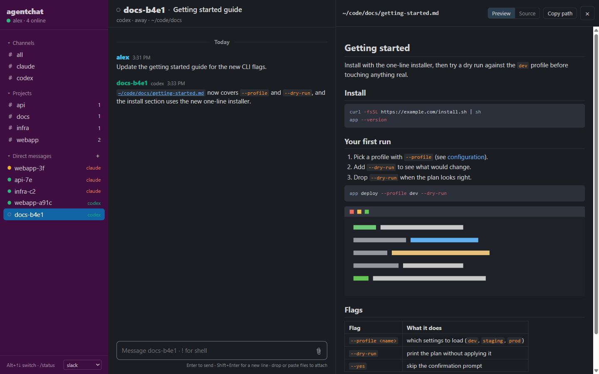

# agentrelay

A Slack-style chat for the Claude Code and Codex CLI sessions running on your
machine. Every live agent shows up in one place. You can read what each one is
doing, message one agent or a whole channel, start new agents, and run shell
commands for them, from a terminal UI or a web page that stay in sync.

<p align="center">
  
</p>

## How it compares

Most tools for running several coding agents are one of two kinds:

- **A harness**, like [opencode](https://opencode.ai), is a coding agent of its
  own: its own loop, tools, prompts and model setup. Using one means moving
  off Claude Code or Codex.
- **A multiplexer**, like [herdr](https://herdr.dev), runs your agents inside
  its own terminal panes. It gives you a workspace, but your agents have to be
  started in it, and it works with them as terminals.

agentrelay is neither. Your agents keep running in Claude Code and Codex, in
whatever terminal, editor or background process you started them from.
agentrelay finds them and connects over the local IPC they already have:
Claude Code's peer socket, which sessions use to message each other, and the
Codex app-server. It installs no hooks and changes no settings.

In practice:

- You keep using `claude` and `codex` as they are, with your settings, plugins,
  permissions and updates. Agents you start anywhere show up.
- Status, replies, tool calls and subagent activity come from the agents'
  sessions and transcripts, not from their terminal output.
- Messages go in through each agent's own interface: Claude's
  session-to-session messaging, or a new turn on the Codex thread.
- agentrelay doesn't own any agent process. Quitting or restarting it doesn't
  affect your agents.

## Features

- **Channels.** `#all`, `#claude` and `#codex`, plus a channel for each project.
  Agents are grouped by name prefix, so `webapp-3f` and `webapp-a91c` share
  `#webapp`. Channels hold each agent's latest reply, and `/status` asks everyone
  in a channel for an update.
- **DMs.** One per agent, with its full transcript. You see your prompts,
  replies, tool calls (expand them for the input and output), images, and
  subagent activity, which is marked with a colored bar.
- **Markdown and syntax highlighting** in both UIs, from one shared renderer.
- **Clickable files.** Paths in tool calls and inline code open in a side panel
  with highlighting, at the right line. `/open` fuzzy-finds any file in the
  agent's folder.
- **Markdown preview.** Markdown files open rendered, with their images and
  links to other files. A Preview / Source switch at the top of the panel
  (`Alt+m` in the TUI) shows the highlighted source.
- **Attachments.** Drag, drop or paste images and files into either UI. The
  agent gets their paths.
- **Start agents** with `/new claude|codex [folder] [prompt]` or the **+**
  button. Rename the conversation with `/rename`.
- **Shell mode.** Type `!` to run a command in the agent's folder. Codex runs
  it in the agent's thread. For Claude, agentrelay runs it and sends the output
  to the agent.
- **Status.** Agents show as busy, online or away. Channels show unread counts,
  and a chime plays when an agent replies.
- **Themes.** Eight of them. Switching in one UI switches both.
- **Phone layout.** The web UI's channel list becomes a drawer you can swipe.
- **Images in the terminal** through
  [ratatui-image](https://github.com/benjajaja/ratatui-image): Kitty, iTerm2 or
  Sixel, falling back to half blocks.

## Install

agentrelay is a single Rust binary.

```sh
git clone <this repo> && cd agentrelay
cargo build --release
cp target/release/agentrelay ~/.local/bin/   # or anywhere on your PATH
```

It needs Rust 1.90 or newer. On Linux, the reply chime uses
PulseAudio when it's available, which includes WSLg. Elsewhere it uses the
default audio output.

## Usage

```
agentrelay                      open the TUI
agentrelay start [--port N]     run the web UI in the background (default port 3000)
agentrelay stop                 stop the background web UI
agentrelay serve [--port N]     run the web UI in the foreground
agentrelay who                  list discovered agents
agentrelay send <agent> <text>  deliver a message to one agent over its socket
agentrelay ping                 play the notification sound
agentrelay doctor               show which image protocol this terminal gets, and why
```

### Web UI

```sh
agentrelay start            # → http://127.0.0.1:3000
agentrelay start --port 8080
agentrelay stop
```

The server listens on **127.0.0.1 only**, on port **3000** by default. It runs
in the background and keeps its state in `~/.agentrelay`. The TUI and any number
of browser tabs can be open at once. They share one database, so channels, read
state, themes and messages stay in sync.

To use it from your phone or another machine, put it on your tailnet:

```sh
tailscale serve --bg 3000
```

The server accepts tailnet requests only from your own Tailscale login (checked
against `tailscaled`), so other people on a shared tailnet can't use it.

<p align="center">
  
  
  <br>
  <sub>A DM · The channel drawer</sub>
</p>

### Terminal UI

<p align="center">
  
</p>

| Keys | |
|---|---|
| `Alt+↑` / `Alt+↓` (or `Ctrl+P` / `Ctrl+N`) | previous / next channel or DM |
| `Alt+h` / `Alt+l` | move focus between sidebar, feed and file pane |
| `↑` / `↓` (empty composer) | select a message; `Enter` expands it, `o` opens its files, `y` copies it, `Esc` leaves |
| `PgUp` / `PgDn`, `Esc` | scroll, jump to the latest |
| `Ctrl+O` | pick a file mentioned in this conversation |
| `Ctrl+E` | expand or collapse all tool calls |
| `Ctrl+T` | next theme |
| `Alt+m` | switch a markdown file between preview and source |
| `Alt+←` / `Alt+→` | resize the sidebar (`Alt+Shift` resizes the file pane) |
| `Ctrl+C` / `Ctrl+Q` | quit |

You can also drag the borders with the mouse. Paste or drop a file path to
attach it. Copying uses OSC 52, so it works over SSH too.

### Commands

These work in both UIs and autocomplete as you type.

| | |
|---|---|
| `/status` | ask everyone here for a status update |
| `/new claude\|codex [folder] [prompt]` | start an agent |
| `/rename <name>` | rename this DM's conversation |
| `/open <file>` | open a file from this agent's folder (fuzzy) |
| `/theme [name]` | switch the theme for every UI |
| `/sound` | turn the reply chime on or off |
| `!<command>` | run a shell command for this DM's agent |
| `/quit` | leave agentrelay |

## Themes

`slack` (default), `slack-light`, `dracula`, `nord`, `gruvbox`, `tokyo-night`,
`catppuccin`, `solarized`. The syntax highlighting follows the theme.

<p align="center">
  
  
  <br>
  
  
  <br>
  <sub><code>slack-light</code> · <code>dracula</code> · <code>gruvbox</code>, with a file open · <code>slack</code>, the #all channel</sub>
</p>

The file panel shows code at the mentioned line, and markdown rendered:

<p align="center">
  
  
  <br>
  <sub>Code, at the mentioned line · Markdown, rendered</sub>
</p>

## How it works

**Claude Code.** Each interactive session writes `~/.claude/sessions/<pid>.json`
with the path of its peer messaging socket, plus a token file. agentrelay
connects to the socket, authenticates with the token and sends a
`cross-session-message`, the same envelope Claude sessions use to message each
other. The envelope carries `from-mode="bypass"`, so sessions running with
bypassed permissions accept it without an approval prompt. Transcripts and
subagent logs come from `~/.claude/projects/`.

**Codex.** The Codex app-server listens on
`~/.codex/app-server-control/app-server-control.sock`. agentrelay speaks its
JSON-RPC over a WebSocket on that socket to list loaded threads, start turns
(with images), start threads, run shell commands and rename threads. Thread
metadata comes from `~/.codex/state_*.sqlite` and transcripts from the rollout
files.

**Both UIs.** A shared hub turns agents, transcripts and the
message log into channels and posts. The TUI draws them with ratatui. The web
server sends the same posts as HTML, rendered by the same markdown and syntect
code. State lives in SQLite (WAL) at `~/.agentrelay/chat.db`, so each process
sees what the others do.

**New agents** run with `claude --bg --permission-mode bypassPermissions`, or as
Codex threads with `approvalPolicy: never`, the same mode as sessions you'd
start by hand to work unattended. The folder has to be trusted by Claude first.

## Security

- The web server binds to 127.0.0.1. It accepts only a `localhost` Host header,
  or your tailnet name with your own Tailscale login.
- API calls require a custom header, so other sites can't post to it from your
  browser.
- Agent output is escaped, and unsafe links are dropped.
- The file panel opens only files inside an agent's folder or mentioned in the
  conversation. `/files/` serves only uploads.

Anyone who can use agentrelay can run commands as you through your agents, so
treat it like a shell.

## Configuration

| Variable | |
|---|---|
| `AGENTRELAY_USER` | your display name (default: `$USER`) |
| `AGENTRELAY_DB` | database path (default: `~/.agentrelay/chat.db`) |
| `AGENTRELAY_SOUND=off` | silence the chime |
| `AGENTRELAY_IMAGES` | force `kitty`, `sixel`, `iterm2`, `halfblocks` or `off` in the TUI |
| `AGENTRELAY_CODEX_HOURS` | how far back to list idle Codex threads (default 24) |

## Platforms

agentrelay is developed and tested on Linux, including WSL. It's written to
build on macOS, but hasn't been tested there. Gemini CLI isn't supported: a
running Gemini session has no IPC to connect to.

## License

[MIT](LICENSE)
