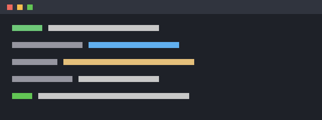

# Getting started

Install with the one-line installer, then try a dry run against the `dev`
profile before touching anything real.

## Install

```sh
curl -fsSL https://example.com/install.sh | sh
app --version
```

## Your first run

1. Pick a profile with `--profile` (see [configuration](configuration.md)).
2. Add `--dry-run` to see what would change.
3. Drop `--dry-run` when the plan looks right.

```sh
app deploy --profile dev --dry-run
```



## Flags

| Flag | What it does |
|---|---|
| `--profile <name>` | which settings to load (`dev`, `staging`, `prod`) |
| `--dry-run` | print the plan without applying it |
| `--yes` | skip the confirmation prompt |

> **Tip:** `app deploy --dry-run` never needs credentials, so it's safe to
> run on any machine.
